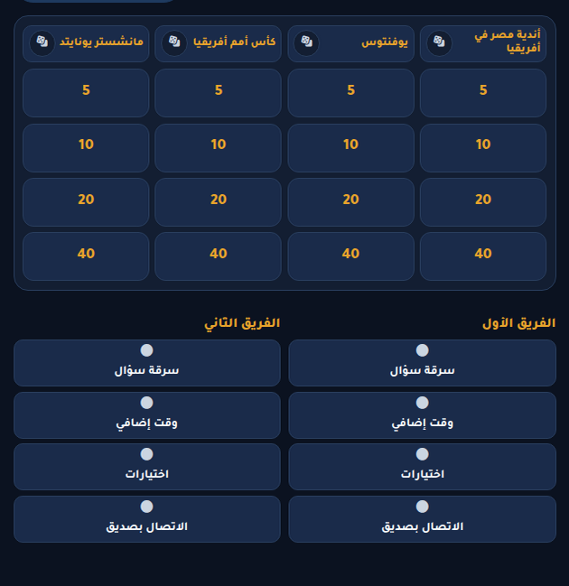
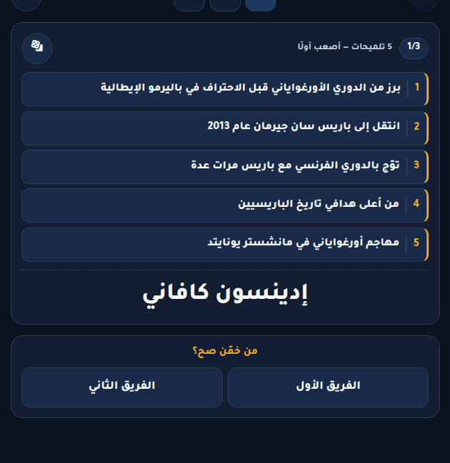
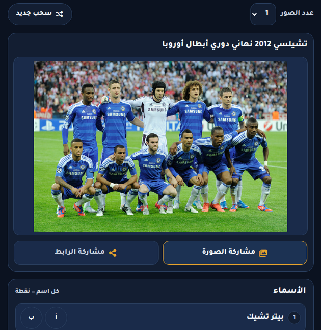

# Masa2o Ta7ady

Get your friends together, split into two teams, and find out who actually remembers all that football trivia. Masa2o Ta7ady (مسائو تحدي) is an Arabic football game-night app, with Egyptian football in the mix alongside clubs and players from around the world.

One person plays referee and runs the app on their phone. Everyone else plays together in the room, without needing an account. Pick a challenge, give your teams names, and start playing. You can stick with one game or try another whenever the group feels like it.

## What are we playing?

There's more here than straight question-and-answer trivia:

- **Password and Acting:** help your teammate guess a footballer, either with a one-word hint or by acting it out without speaking.
- **Ihbid Sahh and Offside:** get as close as you can to a number or date, or come up with a player who fits the prompt without picking the same name as everyone else.
- **Top 10 and Score Sheet:** test your memory of football rankings and the starting elevens from famous matches.
- **Risk and Bank:** go for the bigger points on a category board, or build a rapid-fire answer streak and decide when to bank it before a wrong answer wipes it out.
- **Ana Meen and Who-in-Picture:** work out the mystery footballer from five clues, or put names to the eleven faces in a team photo.

The referee has the answers, timers, and scores on screen. They decide what counts, award points, and can fix the score whenever needed. The app keeps things moving; the football arguments are still yours to settle.

The screens are in Arabic, work right-to-left, and have light and dark themes. You can also add your own questions and import question packs from the question-management page, so the group doesn't have to keep playing the same material.

## A look at the app

These are screenshots from the running app in dark mode. They're the referee's view, so some screens include the answers.

### Risk: pick your category and your points



### Ana Meen: five clues to a footballer



### Who-in-Picture: how many faces do you remember?



## Prerequisites

- **Git** to clone the repository.
- **JDK 17 or newer**; CI uses Java 17. The backend includes a Maven wrapper, so a separate Maven installation is not needed.
- **Node.js and npm**: use Node **24.15.0+ within the 24.x line** and npm **11.17.0** (the version declared in `package.json`). The locked Angular dependencies also accept Node `^22.22.3` or `>=26.0.0`.
- **Docker Engine and Compose v2** for the supplied PostgreSQL service. Alternatively, provide a PostgreSQL instance yourself; the local Compose file uses PostgreSQL **18.6**, and CI uses PostgreSQL 18.
- Free local ports **5432** (database), **8080** (backend), and **4200** (frontend). Internet access is needed for the initial dependency/image downloads and externally hosted game photos.

The commands below use a Bash-compatible shell. On Windows, use `mvnw.cmd` instead of `./mvnw` when running the backend from PowerShell or Command Prompt.

## Run locally

### 1. Clone the repository

```bash
git clone https://github.com/bedo-morad/Masa2o-Ta7ady.git
cd Masa2o-Ta7ady
```

### 2. Start PostgreSQL

From the repository root:

```bash
docker compose up -d postgres
docker compose exec postgres pg_isready -U username -d ta7ady
```

Wait until PostgreSQL reports that it is accepting connections. The local [`docker-compose.yaml`](docker-compose.yaml) starts **only the database**; the backend and frontend run separately below.

The local database defaults are:

| Setting     | Local value      |
| ----------- | ---------------- |
| Host / port | `localhost:5432` |
| Database    | `ta7ady`         |
| Username    | `username`       |
| Password    | `password`       |

These are development-only values, not production credentials. If you run PostgreSQL without Docker, create the database and role with these values, or override the backend configuration as described below.

### 3. Start the backend

In a terminal at the repository root:

```bash
cd ta7ady-backend
./mvnw spring-boot:run
```

The wrapper downloads Maven and dependencies on the first run. The backend connects to PostgreSQL at `localhost:5432` by default and uses Hibernate's `ddl-auto: update` to create/update its tables. No separate migration command is configured.

Verify the API at <http://localhost:8080/api/players?count=1>. A new database returns `[]` until content is imported. Interactive API documentation is available at <http://localhost:8080/swagger-ui/index.html>.

### 4. Start the frontend

In a **second terminal** at the repository root:

```bash
cd ta7ady-frontend
npm ci
npm start
```

Open **<http://localhost:4200/>**. Angular's development server reloads the page when frontend source files change.

Use `localhost`, not a LAN address or `127.0.0.1`, for this default setup: the frontend currently targets `http://localhost:8080/api`, and the backend permits browser API requests from `http://localhost:4200`. Phone/LAN access or different frontend/backend ports need additional API URL/CORS configuration in code; they are not enabled by an environment variable in the current app. See [`ApiService`](ta7ady-frontend/src/app/api.service.ts) and [`WebConfig`](ta7ady-backend/src/main/java/com/ta7ady/backend/web/WebConfig.java).

### 5. Add game content

The server does **not** automatically load the committed [`seeds/`](seeds/) JSON files. The app can start with an empty database, but challenges need content in their corresponding pools.

1. Open <http://localhost:4200/manage> and select the target pool.
2. Use the bulk importer to upload the corresponding JSON file from `seeds/`, or paste its JSON array.
3. Run the dry-run preview, resolve any flagged rows, then confirm the import to save the content. Duplicate entries are rejected rather than silently overwritten.

Password and Acting share `players.json`. Other files correspond to their own pools; Who-in-Picture uses `who in the picture.json`. Its `photoUrl` values reference external images, so image availability depends on those hosts.

For schemas and content rules, see [Authoring](docs/AUTHORING.md). [Bank seed process](docs/BANK_SEED_PROCESS.md) and [Risk seed process](docs/RISK_SEED_PROCESS.md) explain their curated pools. Their `seeds/_review/` authoring tools are git-ignored and are **not required** to run the app or import committed seed files.

## Local configuration

**No `.env` file is needed for the default local setup.** The defaults in [`application.yaml`](ta7ady-backend/src/main/resources/application.yaml) match the local Compose database.

To use a different database or admin password, export environment variables in the terminal where you start the backend. For example, these safe sample values connect to the default local database while replacing the admin password:

```bash
export SPRING_DATASOURCE_URL=jdbc:postgresql://localhost:5432/ta7ady
export SPRING_DATASOURCE_USERNAME=username
export SPRING_DATASOURCE_PASSWORD=password
export ADMIN_PASSWORD=local-admin-example
cd ta7ady-backend
./mvnw spring-boot:run
```

`ADMIN_PASSWORD` defaults to `admin` and unlocks editing/deletion in `/manage`; it is not a player login. Do not expose the development defaults publicly. PostgreSQL is the only required external service for this local setup; no third-party API key is required.

The root [`.env.example`](.env.example) is a reference for the container deployment setup, **not a drop-in local configuration**: it uses database hostname `postgres` and placeholder passwords, whereas a backend running on your machine uses `localhost`. If you already have a root `.env`, check it for conflicting values; the backend is configured to import it when present. Exported environment variables take precedence. The local `docker-compose.yaml` has fixed database credentials and does not read `POSTGRES_*` overrides from that example. For the production Compose configuration and `.env` workflow, see [Deployment](docs/DEPLOY.md).

To stop the local database without deleting its stored questions, run this from the repository root:

```bash
docker compose stop postgres
```

**Storage limitation:** the current local Compose file mounts its named volume at `/data/postgres`, but the PostgreSQL 18 image uses `/var/lib/postgresql/18/docker` by default and expects a volume mounted at `/var/lib/postgresql` ([official image documentation](https://github.com/docker-library/docs/blob/master/postgres/README.md#pgdata)). The named volume therefore does not cover the actual database directory. Stopping the existing container keeps its data, but back up anything important before removing/recreating it; do not rely on the current named volume to preserve imported questions. Avoid `docker compose down -v`, which removes volumes too. This README does not change the Compose configuration.

## Checks

Run backend verification with PostgreSQL available. Prefer a disposable development/test database, not a database containing content you need to preserve; set the `SPRING_DATASOURCE_*` variables above if using a separate database.

```bash
# From the repository root
cd ta7ady-backend
./mvnw -B verify
```

Frontend build and tests (after `npm ci`):

```bash
# From the repository root
cd ta7ady-frontend
npm run build
npm test -- --watch=false
```

These correspond to the backend/frontend checks in [CI](.github/workflows/ci.yml). The frontend production build is written under `ta7ady-frontend/dist/`.

## More documentation

- [Game rules](docs/RULES.md) and [domain glossary](docs/CONTEXT.md): how challenges work and the project's terminology.
- [Authoring](docs/AUTHORING.md): JSON import schemas and question-writing guidance.
- [Code standards](docs/CODE_STANDARDS.md): architecture, referee-first behavior, and quality gates.
- [Deployment](docs/DEPLOY.md): production containers, persistence, and releases.
- [Frontend README](ta7ady-frontend/README.md): additional Angular CLI commands.
